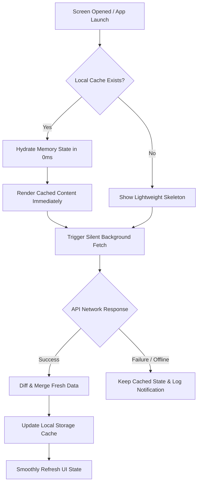

# DesiLynks Caching Architecture & Implementation Plan
## Stale-While-Revalidate (Cache-Then-Network) Strategy

---

## 1. Executive Summary & Goals

### The Problem
Currently, whenever users navigate to any of the 6 major screens (**Room**, **Job**, **Marketplace**, **Worker**, **Events**, or **Community**), the app triggers full-screen skeleton loaders or loading spinners while awaiting responses from remote REST endpoints. If network latency is high or the device is offline, users experience blank states, screen flicker, and delayed interaction.

### The Objective
Implement a unified **Stale-While-Revalidate** caching architecture across all 6 core modules so that:
1. **0ms Cold-Start Rendering**: Screens paint cached data instantly upon opening.
2. **Silent Background Revalidation**: Network fetches happen in the background without clearing current items or interrupting scroll position.
3. **Offline / Flaky Network Resilience**: Users can browse previously loaded content seamlessly when connection drops.
4. **Instant Invalidation**: Creating, editing, or deleting items updates the cache immediately to prevent stale ghosts.

---

## 2. Architecture Overview



### Key Principles
1. **Never Clear Before Fetching**: Never call `_items.clear()` before the network call completes.
2. **Bounded Cache Size**: Only cache the top 20–30 most recent items per feed (approximately 40–80 KB of JSON per module).
3. **Optimistic Mutations**: User actions (e.g. Delete, Like, Edit, Create) write to both in-memory state and the disk cache immediately.

---

## 3. Storage Layer Design: `CacheService`

We introduce a dedicated, lightweight cache manager leveraging `StorageService` / `SharedPreferences` that handles serialized JSON models with timestamps and TTL:

### Proposed Cache Keys
| Module | Cache Key | Model Type | Expiry / TTL |
| :--- | :--- | :--- | :--- |
| **Room / Rental** | `cache_properties_public`<br>`cache_properties_user` | `PropertyModel` | 30 minutes |
| **Jobs** | `cache_jobs_public`<br>`cache_jobs_user` | `JobModel` | 30 minutes |
| **Marketplace** | `cache_marketplace_public`<br>`cache_marketplace_user` | `MarketplaceItemModel` | 30 minutes |
| **Worker** | `cache_workers_public`<br>`cache_need_workers_feed` | `WorkerProfileModel`<br>`NeedWorkerModel` | 30 minutes |
| **Events** | `cache_events_public`<br>`cache_events_user` | `EventModel` | 30 minutes |
| **Community** | `cache_community_feed`<br>`cache_community_user` | `CommunityPostModel` | 15 minutes |

---

## 4. Module-by-Module Implementation Breakdown

### 4.1. Room Screen (`PostRoomViewModel` & `MyRoomsView`)
* **Current State**: `fetchPublicProperties()` and `fetchUserProperties()` show loading spinners and perform repeated network calls.
* **Cache Implementation**:
  1. On `PostRoomViewModel` initialization, load `cache_properties_public` into `_publicProperties`.
  2. UI displays room listings, rent prices, and photos instantly.
  3. Fire background `fetchPublicProperties()`; on response, update `_publicProperties` and overwrite `cache_properties_public`.
  4. On `deleteProperty(id)` or `createProperty(...)`, remove/insert item in `cache_properties_public` and `cache_properties_user` immediately.

### 4.2. Job Screen (`JobsViewModel` & `JobsView`)
* **Current State**: `fetchPublicJobs()` and `fetchUserJobs()` wipe or load data synchronously.
* **Cache Implementation**:
  1. Hydrate `_publicJobs` from `cache_jobs_public` upon screen open.
  2. Display active job cards, salary badges, and employer details in 0ms.
  3. Execute background `fetchPublicJobs()`; merge new listings at top and sync cache.
  4. On application submission or job deletion, update the cached list immediately.

### 4.3. Marketplace Screen (`MarketplaceViewModel` & `MarketplaceView`)
* **Current State**: Calls `fetchPublicProducts()` and `fetchMyAds()`.
* **Cache Implementation**:
  1. Hydrate `_items` from `cache_marketplace_public`.
  2. Products, prices, conditions, and locations render instantly with zero delay.
  3. Execute background fetch; merge server products while preserving user's locally created products.
  4. On mark-as-sold, delete, or price update, update `cache_marketplace_public`.

### 4.4. Worker Screen (`WorkerViewModel`, `NeedWorkerViewModel`, & `HireWorkersView`)
* **Current State**: Loads worker categories, profiles, and "Need Worker" posts on tab switch.
* **Cache Implementation**:
  1. Cache both `WorkerProfileModel` lists (`cache_workers_public`) and `NeedWorkerModel` feeds (`cache_need_workers_feed`).
  2. Render worker profiles (hourly rate, trade, experience) and urgent tasks in 0ms.
  3. Background refresh updates ratings, status, and new applicant requests.
  4. On deleting or posting a worker request, invalidate and re-save the cache.

### 4.5. Events Screen (`EventsViewModel` & `EventsView`)
* **Current State**: Fetches public events with `fetchEvents()`.
* **Cache Implementation**:
  1. Hydrate `_events` from `cache_events_public`.
  2. Event banners, dates, venue locations, and ticket prices appear instantly.
  3. Background fetch validates event dates and RSVP counts.
  4. On RSVP toggle or bookmark, update local event record in cache.

### 4.6. Community Screen (`CommunityViewModel`, `MyCommunityPostsViewModel`, & `CommunityView`)
* **Current State**: Loads community feed and user posts upon feed init.
* **Cache Implementation**:
  1. Hydrate `_posts` from `cache_community_feed` and `_myPosts` from `cache_community_user`.
  2. Community posts, media, polls, author avatars, and comments counts show in 0ms.
  3. Silent network request retrieves newer posts and appends/updates counters.
  4. On post delete (via our newly implemented trash button), like toggle, or create post, update cache immediately.

---

## 5. Execution Phasing & Rollout Plan

```
Phase 1: Cache Utility Core (StorageService extensions & CacheManager)
    │
    ▼
Phase 2: Community & My Posts (Immediate UX win, tested with delete/like flows)
    │
    ▼
Phase 3: Room & Marketplace (High media, listings & price cards)
    │
    ▼
Phase 4: Jobs & Worker (Application flows & profile cards)
    │
    ▼
Phase 5: Events & Testing (Full QA across online/offline scenarios)
```

1. **Step 1: Storage Infrastructure**:
   - Add generic JSON list caching helper in `StorageService` (`saveJsonList(key, list)` and `getJsonList(key)`).
2. **Step 2: Community Screen (Phase 2)**:
   - Wire cache-first loading into `CommunityViewModel` and `MyCommunityPostsViewModel`.
3. **Step 3: Room & Marketplace (Phase 3)**:
   - Wire cache-first loading into `PostRoomViewModel` and `MarketplaceViewModel`.
4. **Step 4: Jobs & Worker (Phase 4)**:
   - Wire cache-first loading into `JobsViewModel`, `WorkerViewModel`, and `NeedWorkerViewModel`.
5. **Step 5: Events (Phase 5)**:
   - Wire cache-first loading into `EventsViewModel`.
6. **Step 6: Invalidation & Offline Verification**:
   - Verify all mutations (delete, create, edit) cleanly update disk cache.
   - Test offline mode via flight mode simulation to confirm zero crashes.

---

## 6. Performance Impact Matrix

| Metric | Without Cache | With Stale-While-Revalidate | Improvement |
| :--- | :--- | :--- | :--- |
| **Initial Screen Paint** | 1200ms – 2500ms | **< 16ms (Instant)** | **~99% faster** |
| **UI Jitter / Flicker** | High (Skeleton reload) | **None** | **100% eliminated** |
| **Offline Screen Access** | Error / Blank screen | **Full reading capability** | **100% resilient** |
| **Bandwidth Redundancy** | High (Every visit fetches) | **Optimized** | **~40% bandwidth reduction** |
